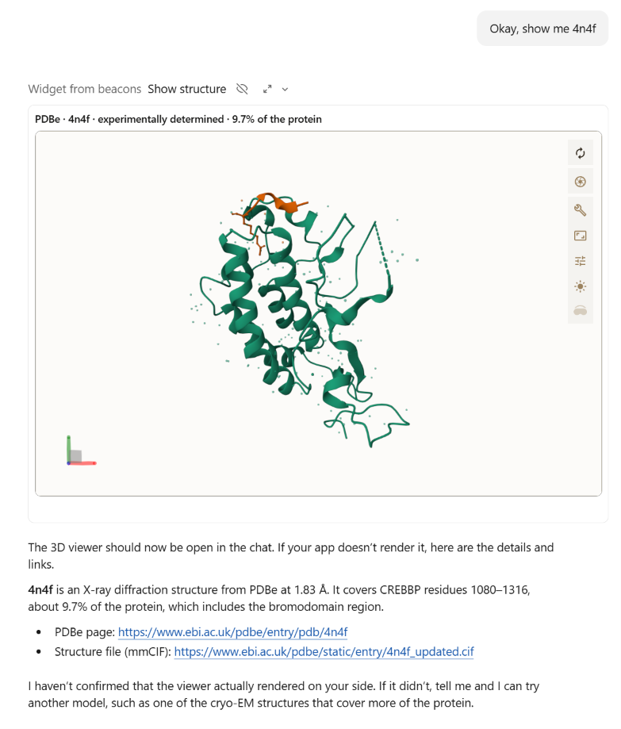
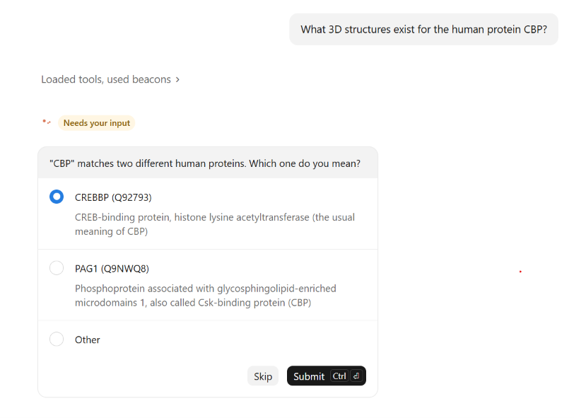
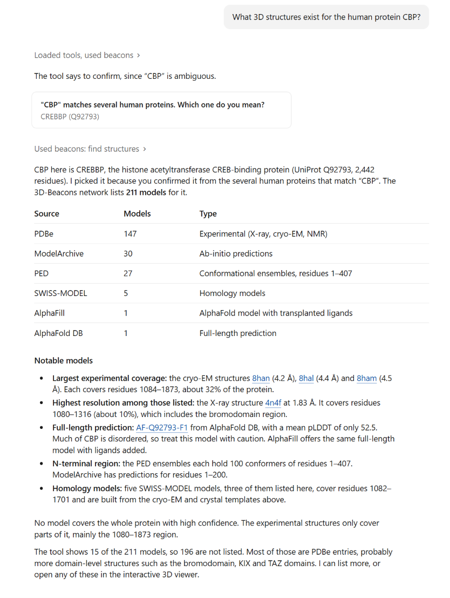

# beacons-mcp

**What:** an [MCP](https://modelcontextprotocol.io) server that lets an AI assistant find the
3D structures of a protein through the [3D-Beacons](https://www.ebi.ac.uk/pdbe/pdbe-kb/3dbeacons/)
network, and open one in an interactive viewer inside the chat.

**Why:** a protein can have hundreds of structure models from a dozen providers. An assistant
needs help to choose between them, and to show one without passing the whole file through the
conversation.



## What's worth a look

- **Asking, not guessing.** When a name matches several proteins ("CBP" does), the user is
  asked to choose. If the client offers a form, the pick comes back marked `confirmed_by_user`.
  [Details](docs/design.md#asking-which-protein)
- **A viewer that keeps files out of the model's context.** `show_structure` opens
  [Mol*](https://molstar.org) in the chat, and on the direct route the page loads the file from
  the provider itself, so the model never reads it. [Details](docs/design.md#how-a-structure-reaches-the-viewer)
- **Ranking hundreds of models.** The experimental model that spans the most of the protein
  comes first, then the rest by span, spread across providers so that none crowds out the
  others. [Details](docs/design.md#choosing-which-models-to-show)
- **A lab notebook.** [`docs/lab-notebook/`](docs/lab-notebook/) records what was tried in
  which Claude app, what failed and why.

> **Author's note.** In past years I was involved in the development of the original release of
> 3D-Beacons. I am no longer affiliated with EMBL-EBI. This is an independent personal project
> and **not an official product** of 3D-Beacons, EMBL-EBI or UniProt.

**Status, November 2026:** a working prototype. Tried in the MCP Inspector and in the Code tab
in Claude Desktop (on Windows). Not yet tried in Claude Code (terminal) or Claude Desktop chat,
and claude.ai cannot use it yet (see [Limits](#limits)).

## Quick start

You need Python 3.12 or newer and [uv](https://docs.astral.sh/uv/). Node 22.12 or newer is
needed only for the viewer (step 3).

```bash
git clone https://github.com/mvaradi/beacons-mcp.git
cd beacons-mcp
uv sync
```

**1. Add the server to a client.** Two names are used in this README. *Claude Code (terminal)*
is the command-line app. *The Code tab in Claude Desktop* runs Claude Code sessions inside the
desktop app.

- **Claude Code (terminal), or the Code tab in Claude Desktop.** Open this folder. `.mcp.json`
  registers the server as `beacons` (it runs `uv run beacons-mcp`, with no absolute paths).
  Project servers have to be approved. In the Code tab it did not appear until I approved it by
  creating `.claude/settings.local.json` (git-ignored) containing
  `{"enabledMcpjsonServers": ["beacons"]}`, then starting a new session.
- **Claude Desktop (chat).** Not tried. Per Anthropic's documentation, Claude Desktop starts
  local servers from `claude_desktop_config.json` (Settings, Developer, Edit Config). That file
  holds absolute paths, so it is never committed:

  ```json
  {
    "mcpServers": {
      "beacons": {
        "command": "uv",
        "args": ["run", "--directory", "C:\\path\\to\\beacons-mcp", "beacons-mcp"]
      }
    }
  }
  ```

- **No Claude at all.** `uv run mcp dev src/beacons_mcp/server.py` opens the MCP Inspector.
  Its **Apps** tab renders the viewer.

**2. Ask a first question.** For example: *"What 3D structures exist for the human protein
CBP?"* "CBP" matches several human proteins, so the assistant should ask which one you mean.
Choose CREBBP (Q92793).



The answer lists the models by provider, with the best ones ranked:



Then ask for one model, for example *"Okay, show me 4n4f"*, which opens the viewer shown at the top.

**3. Optional: build the viewer.** Without it, `show_structure` still works but returns text and
the file address only, and says the viewer is not built.

```bash
cd viewer
npm install
npm run build    # writes src/beacons_mcp/ui/viewer.html (about 5 MB, not committed)
```

## Tools

| Tool | What it does |
|---|---|
| `search_proteins(query, organism, max_results=5)` | Maps a protein or gene name plus an **organism** to UniProt accessions, using the [UniProt REST API](https://www.uniprot.org/help/api). Gene synonyms match and reviewed (Swiss-Prot) entries come first. The organism is required and never assumed: the model is told to ask the user. |
| `find_structures(uniprot_accession, max_results=10)` | Lists the structure models for an accession from the [3D-Beacons Hub](https://www.ebi.ac.uk/pdbe/pdbe-kb/3dbeacons/api/v2/openapi.json): totals by provider and category, then a selection of models with residue range, how much of the protein each spans, resolution or confidence, and file URL and format. It returns links and downloads nothing. |
| `show_structure(uniprot_accession, model_id)` | Opens one model from `find_structures` in an interactive [Mol*](https://molstar.org) viewer inside the chat, in apps that support [MCP Apps](https://modelcontextprotocol.io/extensions/apps/overview). Other clients get a text summary and the file URL. |

A fourth tool, `fetch_structure_file`, exists only for the viewer. It is app-only, so hosts
keep it from the model. All tools carry the MCP read-only annotation (a hint to clients): they
only make GET requests, and write nothing to disk. Expected failures (no match, unknown
accession, a slow or unavailable service, a file that is too large) come back as tool errors
that say what to try next.

## Design decisions

Each is explained in [`docs/design.md`](docs/design.md).

- **Model IDs, not URLs.** `show_structure` takes an accession and a `model_id`, and looks the
  model up in the Hub every time, so the model can never make the server fetch an address of its
  choosing. [Why](docs/design.md#show_structure-takes-a-model_id-never-a-url)
- **Ask, don't assume.** The organism is required. An ambiguous protein name triggers a pick
  list, and `confirmed_by_user` tells the model when a person made the choice.
  [Why](docs/design.md#asking-which-protein)
- **Rank by span, experimental first, spread across providers,** and report each Hub item as
  the Hub lists it. [Why](docs/design.md#choosing-which-models-to-show)
- **Providers are data, not code.** Descriptions and the viewer's allowed hosts come from the
  3D-Beacons registry, live with a bundled fallback; no provider name appears in the source.
  [Why](docs/design.md#provider-descriptions-and-the-registry)
- **The file does not pass through the model.** The viewer page fetches it from the provider,
  with the server as a second route. [Why](docs/design.md#how-a-structure-reaches-the-viewer)
- **A locked-down viewer.** Its content security policy allows only the providers' hosts, and
  the server's own downloads reach only public addresses. See [Security](#security).
- **stdout belongs to the protocol.** All logging goes to stderr.
  [Why](docs/design.md#logging-and-stdout)
- **Public SDK only.** Tests fail if the code touches the MCP SDK's internals.
  [Why](docs/design.md#public-sdk-only)

## Limits

As of November 2026.

- **Where it works.** [Details](docs/design.md#where-it-has-been-tried).
  - *MCP Inspector:* everything, including both file routes.
  - *The Code tab in Claude Desktop:* the tools work. The model asks which protein using its own
    question tool, not the form. The viewer rendered a PDBe model through the direct route.
  - *Claude Code (terminal):* not tried. Anthropic's documentation says it shows
    [text only](https://claude.com/docs/connectors/building/mcp-apps/quickstart).
  - *Claude Desktop (chat):* not tried.
  - *claude.ai:* **cannot use this server yet.** It runs over stdio, and claude.ai connectors
    need a server that Anthropic's infrastructure can reach, which a process on your own machine
    is not ([Anthropic's guidance](https://claude.com/docs/connectors/building/testing.md)).
    Serving it over Streamable HTTP and hosting it is not built.
- **MCP Apps clients.** The MCP documentation lists Claude, Claude Desktop, VS Code GitHub
  Copilot, Microsoft 365 Copilot, Goose, Postman, MCPJam and Archestra.AI as supporting MCP Apps
  ([source](https://modelcontextprotocol.io/extensions/apps/overview)). I have only tried the
  Code tab in Claude Desktop and the MCP Inspector.
- **Providers without CORS headers.** In my check of 14 November 2026, three of the ten
  providers that appeared (PED, levylab and Bindome) sent none
  ([method and results](docs/design.md#provider-cors-check)). The page cannot load their files
  itself, so it asks the server, and hosts that do not let an app call server tools (the Code tab
  in Claude Desktop) would show the links instead.
- **Size and format.** Files over 8 MB unpacked are refused, with the address to download from
  (`BEACONS_MCP_MAX_FILE_MB` changes it). Only mmCIF and PDB text is shown.
- **Ensembles** show the provider's sample file and say so. Whole ensembles are not rendered.
- **Speed.** The page is about 5 MB. In my tests in the MCP Inspector the first draw took 15 to
  30 seconds.
- **Elicitation.** The pick-list form is tested with stand-in clients but I have not seen it in
  a real Claude app. Anthropic's
  [Claude Code documentation](https://code.claude.com/docs/en/mcp) describes elicitation.
- **Not every model is listed.** `find_structures` shows a selection. The totals cover all of
  them.
- **Timeouts.** Calls to UniProt, the Hub and providers wait up to 30 seconds for data (10 to
  connect). The registry fetch waits 5 seconds. These are per-read limits, not a total deadline, and the viewer page's own fetch sets no
  timeout.

## Security

- **Local only.** The server speaks stdio: it opens no port and stores no credentials. Its
  requests carry a `beacons-mcp/<version>` User-Agent and nothing else about you.
- **The model cannot choose an address.** See "Model IDs, not URLs" above.
- **The server's downloads** reach only public web addresses (http or https): never localhost, private or
  link-local networks, or cloud-metadata addresses, and the same holds for each redirect (at
  most five). A name is checked by resolving it. Size is capped while streaming and after
  unpacking. Limits: the name is resolved once to check and again to connect, so an attacker who
  controls DNS could in principle get past the check; any port on a public address is allowed;
  and the fixed calls to UniProt, the Hub and the registry follow redirects without these
  checks.
- **The viewer's content security policy** declares the providers' hosts from the registry and
  nothing else: no outside scripts, styles, images or fonts. The host applies it; the MCP
  Inspector did (the page once failed under it).
- **Tokens** from `show_structure` last 15 minutes, name one Hub-resolved model, and live in
  memory (at most 16). In Claude the model is shown the token as part of the result. It only
  works with the app-only tool, which hosts keep from the model.
- **App-only visibility** is a label that hosts enforce. It is not a security boundary.

## Development

```bash
uv sync
uv run pytest            # unit tests, no network needed
uv run pytest -m live    # also call the real UniProt and 3D-Beacons services
uv run ruff check .
cd viewer && npm test    # the viewer's unit tests (decoding, reading results, loading files)
```

The unit tests mock HTTP with [respx](https://lundberg.github.io/respx/) against real responses
saved in `tests/fixtures/` (see the README there). `tests/test_viewer_build.py` is skipped until
the viewer has been built.

The viewer is a small Node project in `viewer/` (Mol* and the MCP Apps client, bundled by Vite
into one HTML file). It needs Node 22.12 or newer. The build stubs out Mol*'s MP4 encoder, which
a sandbox's content security policy would stop from loading, and keeps the third-party licence
notices as a comment at the top of the page.

## Data and attribution

The code in this repository is MIT-licensed (see [Licence](#licence)). The data it returns is
not mine. Protein records come from UniProt, structure models come from the providers in
3D-Beacons, and each stays under its own licence. Please cite what you use. Licences and
citations below are taken from the sources' own pages.

| Source | Licence | Cite |
|---|---|---|
| UniProt (protein search) | CC BY 4.0 for all copyrightable parts of its databases ([UniProt licence](https://www.uniprot.org/help/license)) | The UniProt Consortium. UniProt: the Universal Protein Knowledgebase in 2025. *Nucleic Acids Res.* 53:D609–D617 (2025). [doi:10.1093/nar/gkae1010](https://doi.org/10.1093/nar/gkae1010). [How to cite](https://www.uniprot.org/help/publications) |
| 3D-Beacons Hub | CC BY 4.0: the Hub's API description says so, and the paper states that all data in the network are freely available for academic and commercial use under CC BY 4.0 terms. The network's code repositories are Apache-2.0 | Varadi M, Nair S, Sillitoe I, et al. 3D-Beacons: decreasing the gap between protein sequences and structures through a federated network of protein structure data resources. *GigaScience* 11:giac118 (2022). [doi:10.1093/gigascience/giac118](https://doi.org/10.1093/gigascience/giac118), [PubMed 36448847](https://pubmed.ncbi.nlm.nih.gov/36448847/) |
| Mol* (the viewer) | MIT | Sehnal D, Bittrich S, Deshpande M, et al. Mol* Viewer: modern web app for 3D visualization and analysis of large biomolecular structures. *Nucleic Acids Res.* (2021). [doi:10.1093/nar/gkab314](https://doi.org/10.1093/nar/gkab314) |
| MCP Apps client (the viewer) | MIT (the npm package's licence field). The project's LICENSE file says it is moving to Apache-2.0 | none requested |

Joining the 3D-Beacons network requires a provider's data to be open access, so every provider
licenses its data under CC BY 4.0 or CC BY-SA 4.0 at most. A model stays under the licence of the
provider that serves it. Two providers state more on their own pages:

- **PDB archive data** (served by PDBe): CC0 1.0, per the
  [wwPDB usage policies](https://www.wwpdb.org/about/usage-policies), which encourage attributing
  the original authors.
- **SWISS-MODEL:** CC BY-SA 4.0, and the page asks for its papers to be cited
  ([terms of use](https://swissmodel.expasy.org/docs/terms_of_use)).

Each provider's own citation is on its website; their addresses are in the
[3D-Beacons registry](https://github.com/3D-Beacons/3d-beacons-registry). Two I checked: cite
Kikhney AG, Borges CR, Molodenskiy DS, Jeffries CM, Svergun DI (2020), *Protein Science*
29(1):66–75 for SASBDB, and the AlphaFill paper (Hekkelman et al.,
[*Nature Methods* 2023](https://www.nature.com/articles/s41592-022-01685-y)) for AlphaFill.

The viewer's handling of the MP4 encoder and of licence notices follows the approach in
[PDBe-MCP-Servers](https://github.com/PDBeurope/PDBe-MCP-Servers) (Apache-2.0), and its use of
the MCP Apps client follows the examples in
[ext-apps](https://github.com/modelcontextprotocol/ext-apps). No code was copied.

## Licence

[MIT](LICENSE)
